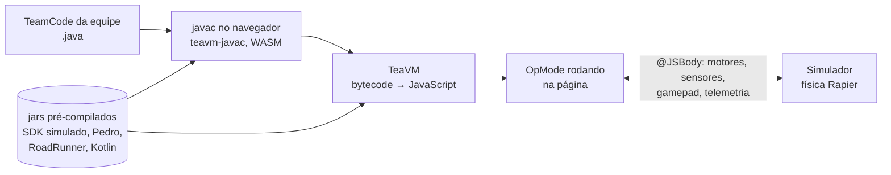

# M5a — Java do Android Studio no navegador: resultados

> Buzz Simulator. Criado por Lucas Hochmann Rosa (https://github.com/contatolucashrosa-bit), em parceria com WestSharksFTC #24823.
> Medições de 01/11/2026, num PC com Windows 11 e navegador baseado em Chromium. Ainda **não** foram medidas num Chromebook.

## Pergunta
Dá para importar o TeamCode de uma equipe (Java do Android Studio, com Pedro Pathing e RoadRunner) e rodar no navegador, **offline e sem servidor**, sem alterar o código?

## Resposta: sim
Nos três cenários abaixo, o código compilou e rodou no navegador **sem nenhuma alteração**.

| Cenário | Arquivos | javac | TeaVM (Java → JS) | Execução |
|---|---|---|---|---|
| OpMode básico (motores, IMU, telemetria formatada, `RUN_TO_POSITION`) | 1 | 29 ms | 2,7 s | 64 voltas/s; `RUN_TO_POSITION` parou a 5 ticks do alvo |
| Pedro Pathing 3.0.2 (`Mecanum`, `PinpointLocalizer`, `Paths`) | 1 + biblioteca | 59 ms | 3,0 s | Localizador mediu o deslocamento |
| **Quickstart oficial do RoadRunner 1.0, inteiro** (`MecanumDrive`, localizadores, tuning, mensagens) | 21 | 370 ms | 7,4 s | `MecanumDrive`, `LazyImu`, `FlightRecorder` e encoders rodam |
| 63 amostras oficiais do SDK FTC 11 (cada uma isolada) | 63 | 1,8 s no total | — | **24 compilam**; das 39 restantes, 26 dependem de visão (AprilTag/VisionPortal, M7) |

O Quickstart do Pedro também foi verificado com o javac do JDK: o `Constants.java` (onde a equipe configura o robô) compila; só os "tuners" não, porque usam a biblioteca de ajuste automático do Pedro, que sobe um servidor web no Control Hub.

## Como funciona

- **SDK FTC simulado** (`src/java/sdk`):
  - escrito do zero;
  - as assinaturas públicas foram conferidas com `javap` no SDK oficial 12.0 (RobotCore e Hardware);
  - cobre OpMode/LinearOpMode, HardwareMap, DcMotor/Ex, Servo, CRServo, IMU, Gamepad (inclusive `aWasPressed()`), Telemetry, ElapsedTime, Range, unidades e RobotLog;
  - simula Pinpoint, SparkFun OTOS, OctoQuad e LynxModule.
- **Ritmo do laço:** `opModeIsActive()`, `idle()` e `sleep()` esperam o **próximo passo da física** (`@Async` + `globalThis.__buzzHw.onNextStep`). Assim, o laço da equipe roda no ritmo da simulação, como num Control Hub, e pausa junto com o jogo.
- **Controle dos motores:** `RUN_TO_POSITION` e `RUN_USING_ENCODER` são controlados pelo simulador, independentes do laço do OpMode, como no hardware real.

## Problemas encontrados e soluções

| Problema | Solução |
|---|---|
| No backend **wasm-gc** do TeaVM, `String.format("%.1f", x)` quebra dentro de `DecimalFormat` (ponteiro nulo) | Usar o **backend JavaScript** do TeaVM, onde a formatação funciona |
| `Thread.sleep(1)` do TeaVM limita o laço a ~66 voltas/s, e um `yield` vazio fica rápido demais | Sincronizar com o passo da física (`Hw.sync()`) |
| A biblioteca de assinaturas do javac do navegador não tem `Object.getClass()`, `wait()` nem `notify()` (usa nomes internos do TeaVM) | `scripts/patch-teavm-classlib.mjs` troca só a assinatura de `java.lang.Object` pela do JDK |
| O RoadRunner pede `RobotLog`, `HardwareMap.getNamesOf`, versão de firmware e `hardwareMap.voltageSensor` não vazio | Implementados no SDK simulado |

## Limitações conhecidas
1. **Diferenças do backend JavaScript:**
   - `%.1f` arredonda "meio para o par" (1,25 vira "1,2"; no Java real, "1,3");
   - um `NullPointerException` não pode ser capturado com `try/catch`: ele encerra o OpMode, o que na prática é o mesmo efeito do robô real;
   - a pilha de chamadas das exceções vem vazia, então as mensagens de erro precisam de outra fonte de linha (a fazer no M5).
2. **Tempo de tradução:** 3 a 7,5 s neste PC, e mais em Chromebook. Mitigação no M5:
   - traduzir num Web Worker, com barra de progresso;
   - guardar o resultado no IndexedDB, para recompilar só quando o código mudar.
3. **Visão** (AprilTag, VisionPortal, Limelight, câmeras) ainda não existe no SDK simulado → M7.
4. **Kotlin no código da equipe:** não é suportado, porque não há compilador Kotlin offline no navegador. Bibliotecas Kotlin já compiladas, como o RoadRunner, funcionam.
5. **Tuners do Pedro** (AutoTune com servidor web) não se aplicam ao simulador. O plano é oferecer constantes já ajustadas para o robô simulado.
6. **Navegador:** o compilador usa WasmGC (Chrome/Edge 119+, Firefox 120+, Safari 18.2+). Em navegadores mais antigos, a biblioteca cai automaticamente no `compiler.js`.

## Tamanho do download (gzip)

| Parte | Tamanho | Quando é baixada |
|---|---|---|
| Compilador (`compiler.wasm` + classlibs + JS) | ~4,2 MB | Ao usar código Java pela primeira vez |
| SDK simulado + Pedro | ~0,2 MB | Idem |
| RoadRunner + Dashboard + Kotlin | ~2,0 MB | Só se o projeto usar RoadRunner |
| `compiler.js` (alternativa sem WasmGC) | ~1,4 MB | Só em navegador sem WasmGC |

Total do app com Java e RoadRunner: cerca de 8 MB, dentro da meta de 15 MB. Depois do primeiro acesso, fica guardado (PWA, M12).

## Decisão
**TeaVM (backend JavaScript) como runtime Java único**, com o SDK simulado, Pedro e RoadRunner pré-compilados. A integração com o jogo é o **M5**:
- `HardwareBus` real ligado ao robô simulado;
- Worker de compilação e cache no IndexedDB;
- importação de pasta ou `.zip` do Android Studio;
- escolha de OpModes `@Autonomous` e `@TeleOp`;
- erros de compilação em português, com arquivo e linha.

## Como reproduzir
1. `npm run dev`.
2. Na primeira vez, prepare a pasta `tmp-spike/` com as amostras oficiais do FtcRobotController e o TeamCode do road-runner-quickstart, mais o `manifest.json`. Essa pasta não vai para o git.
3. Abra `http://localhost:5173/m5a.html`. A página roda os quatro testes e imprime os tempos.
