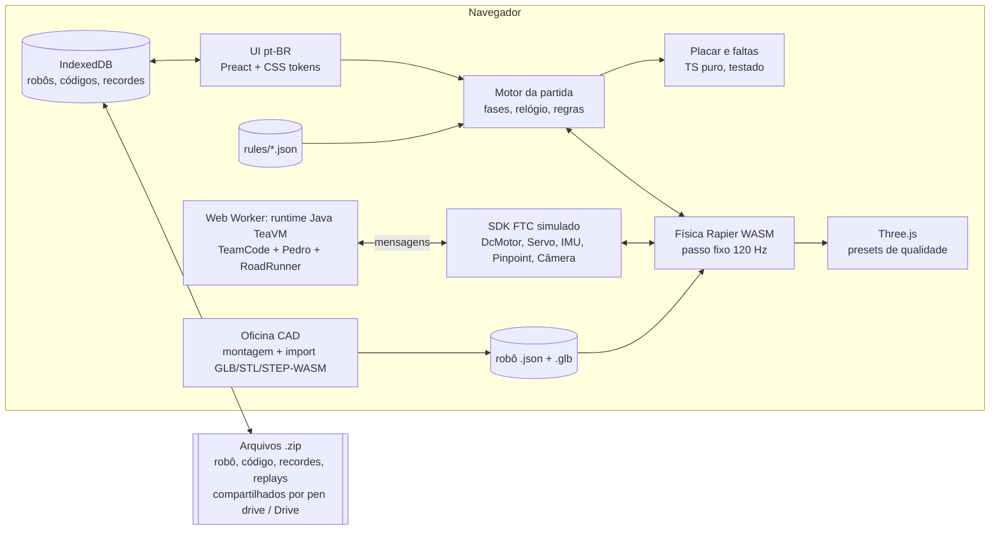
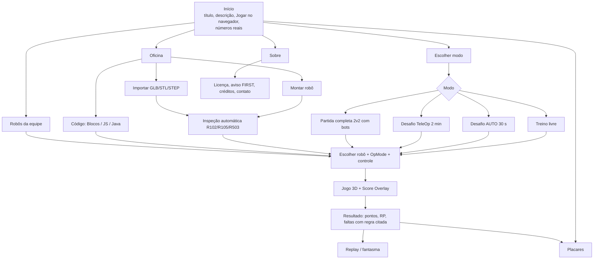

# Fase 1 — Análise do Buzz Simulator (FTC BIOBUZZ™)

> **Buzz Simulator** (repositório `ftc-buzz-simulator`). Criado por Lucas Hochmann Rosa — https://github.com/contatolucashrosa-bit — em parceria com WestSharksFTC #24823.
> Projeto independente, não afiliado nem endossado pela *FIRST*®.
> Data: 01/11/2026 · Manual de referência: **2026-2027 FIRST® Tech Challenge Competition Manual — BIOBUZZ™ presented by RTX, versão TU07** (171 páginas).

**Como li o manual:** li por inteiro as seções que o simulador precisa reproduzir: 8 a 12 (jogo, ARENA, pontuação, regras G e R) e 16 (glossário). Também conferi as figuras 9-2, 9-5, 10-2 e 10-5. As seções 1 a 7 e 13 a 15 tratam de evento, prêmios e torneio; delas, só passei os olhos e extraí o que afeta a partida (13.6.3, sobre ranking, e 15.2, sobre modificações no Mundial). As páginas citadas são as do rodapé do manual ("X of 171").

**Legenda:** *(suposição)* = não está no manual · ⚠️ = ambiguidade do manual.

---

## 1. Resumo das regras do BIOBUZZ

### 1.1 Visão geral (§8, p.60)
Duas ALLIANCES (alianças), com 2 equipes cada, coletam POLLEN (pólen) e NECTAR (néctar). Os elementos são LAUNCHED (lançados) nas CELLS da HIVE (colmeia) da aliança e colocados nas FLOWERS (flores). Quando a CELL de cima recebe elementos suficientes, a HIVE vira (TIP), o que vale pontos e libera mais NECTAR para a aliança.

### 1.2 Campo (ARENA, §9)
| Item | Valor | Fonte |
|---|---|---|
| FIELD (campo) | 144 × 144 pol (365,75 cm), 36 TILES (placas) de 24 pol | §9.2 p.62 |
| Tolerância geral | ±1 pol (±2,5 cm). O modelo **CAD oficial** é a referência de medidas | §9.1 p.61 |
| Grade | Colunas A–F, linhas 1–6. Vermelho = A, B, C; azul = D, E, F | §9.4 p.65; G304 p.102 |
| ALLIANCE AREA (área da aliança) | 97 × 54 pol, fora do campo. A vermelha fica à esquerda de quem olha da plateia | §9.3 p.63; §9.5 p.66 |
| LOADING ZONE (zona de carga) | 23 × 11 pol, junto à parede, ao lado da área da própria aliança | §9.3 p.63 |
| GARDEN (jardim) | 23 × 2 pol, em cantos opostos do campo | §9.3 p.64 |
| Estrutura da HIVE | Centro do campo. Base de 49,46 × 38,95 pol, pivôs a 43,95 pol de altura | §9.6.1 p.67 |
| HIVE / CELL | 1 HIVE por aliança, cada uma com 2 CELLS a 18,8 pol uma da outra. A HIVE é biestável. Abertura da CELL: 20 × 14 × 12 pol | §9.6.2 p.68 |
| FLOWER (flor) | 4 unidades, presas à parede. Boca de 4 pol de diâmetro a 21,5 pol de altura. Abertura inferior de 3,55 × 3,57 pol para retirar POLLEN | §9.7 p.70 |
| AprilTags | Família 36h11, 3,25 pol. IDs 30–45, em grupos de 4 na face de baixo de cada CELL | §9.9 p.72–74 |

⚠️ O manual não informa as coordenadas exatas das FLOWERS, LOADING ZONES e GARDENS. Estimei as posições pelas figuras 9-2 e 9-5 e marquei-as como *suposição* em `data/rules/biobuzz-tu07.json`. Devem ser conferidas no CAD oficial (§9.1).

### 1.3 Elementos de jogo (§9.8 p.72; §10.3.1 p.81–82)
- **POLLEN:** 40 bolas amarelas de 2,8 pol (7,1 cm). Distribuição inicial: 4 em cada FLOWER (16), 4 em cada GARDEN (8) e 4 pré-carregadas em cada robô (16).
- **NECTAR:** 8 vermelhas e 8 azuis, de 3,6 pol (9,1 cm). Distribuição inicial: 3 na CELL virada para cima de cada aliança e 5 na ALLIANCE AREA.
- O manual avisa que os elementos não são esferas perfeitas e variam de tamanho.
- A massa dos elementos não consta no manual *(suposição: será medida)*.

### 1.4 Fases da partida (§10.1 p.79; §10.4 p.83; Tabela 9-1 p.77)
| Fase | Duração | Relógio |
|---|---|---|
| AUTO (autônomo) | 30 s | 2:30 → 2:00 |
| Transição | 8 s (robôs parados, G403) | contagem 0:08 → 0:01 |
| TELEOP (controlado) | 2 min | 2:00 → 0:00 |
| Marco: FLOWERS liberadas | — | 1:00 |
| Marco: 20 s finais | — | 0:20 |

**"Endgame":** ⚠️ o manual não usa esse termo. O equivalente é o último minuto (a partir de 1:00):
- NECTAR pode entrar nas FLOWERS (G410 p.107);
- o HUMAN PLAYER (jogador humano) pode introduzir todo o NECTAR restante (G426 p.114);
- no fim, conta o PARK na LOADING ZONE e o conteúdo de CELLS, FLOWERS e GARDENS.

### 1.5 Pontuação (Tabela 10-2 p.89; critérios §10.5 p.84–88)
| Conquista | AUTO | TELEOP | Quando é avaliada |
|---|---|---|---|
| LEAVE (sair da parede) | 3 | — | fim do AUTO |
| PARK (na LOADING ZONE) | 5 | 5 | fim do AUTO / fim da partida |
| HIVE TIP | 20 | 20 | durante toda a partida. TIP concluído antes do TELEOP conta como AUTO (§10.5.B) |
| Elemento na CELL virada para cima | — | 2 cada | fim da partida |
| Bottom NECTAR Bonus (NECTAR mais baixo na FLOWER) | — | 5 | fim da partida |
| Elemento em FLOWER da qual a aliança é dona | — | 2 cada | fim da partida |
| Elemento no GARDEN | — | 1 cada | fim da partida |

- **Dona da FLOWER:** a aliança com o NECTAR mais alto dentro do volume de pontuação, que vai do anel do topo ao anel do meio. Ela ganha pontos por **todos** os elementos nesse volume, de qualquer cor (§10.5.2 p.86, Fig. 10-5).
- **GARDEN:** pontua para a aliança da cor do GARDEN, não importa quem colocou o elemento (§10.5.3 p.87).
- **TIP:** a HIVE troca de estado estável e o amortecedor encosta na estrutura (§10.5.1 p.85). O único jeito válido de causar um TIP é lançar elementos na CELL de cima (G417).
- **RANKING POINTS** (pontos de ranking, Tabela 10-2/10-3 p.89):
  - SWARM: LEAVE + PARK ≥ 16 pontos (máximo possível por aliança: 26);
  - POLLINATOR 1: ≥ 4 TIPs;
  - POLLINATOR 2: ≥ 7 TIPs;
  - vitória: 3 RP; empate: 1 RP.
  - Esses limiares valem para "All Other Events". Para Regionais e Mundial, o manual diz "TBA" (a definir).
- **Desempate no ranking** (§13.6.3): pontos sem faltas → média de TIPs → média de pontos no AUTO → sorteio.

### 1.6 Penalidades (Tabela 10-4 p.90)
- **MINOR FOUL** (falta menor) = +5 pontos para o adversário.
- **MAJOR FOUL** (falta maior) = +20 pontos para o adversário.
- YELLOW e RED CARD (cartões amarelo e vermelho), DISABLED (robô desativado) e DISQUALIFIED (desclassificado).
- Termos de duração: MOMENTARY < 3 s, CONTINUOUS > 10 s (§10.6 p.90).

Faltas que o simulador consegue detectar sozinho:

| Regra | Infração | Penalidade |
|---|---|---|
| G402 p.104 | Interferir no lado adversário durante o AUTO | MAJOR por partida |
| G403 / G404 p.104–105 | Movimento motorizado na transição ou depois de 0:00 | aviso (MAJOR + amarelo se STRATEGIC) |
| G405 p.105 | Ejetar elemento para fora do campo | MAJOR por elemento |
| G407 p.106 | Controlar mais de 4 elementos | aviso / MAJOR se STRATEGIC |
| G408 p.106 | Controlar NECTAR adversário | aviso |
| G409 p.107 | "Pegar no ar" elementos que caem da HIVE | aviso |
| G410 p.107 | NECTAR na FLOWER antes de 1:00 | MAJOR por NECTAR |
| G417 / G418 p.109–110 | Mexer na HIVE ou na FLOWER de forma ilegal | aviso / MAJOR + amarelo |
| G421 p.112 | PIN (prender o adversário) por mais de 3 s | MAJOR + 1 MAJOR a cada 3 s |
| G426 p.114 | NECTAR introduzido antes de ser liberado | MINOR por NECTAR |
| G427 p.115 | NECTAR introduzido fora da LOADING ZONE | MINOR por NECTAR |

As regras que dependem de intenção ("STRATEGIC") só podem ser **sinalizadas** pelo simulador, nunca julgadas.

### 1.7 Limites do robô (§12)
| Limite | Valor | Fonte |
|---|---|---|
| Configuração inicial | Cubo de 18 × 18 × 18 pol (45,7 cm). O POLLEN pré-carregado pode ficar para fora | R102 p.119 |
| Expansão máxima | 18 × 24 pol na horizontal × 29 pol de altura, limitada por meio físico (não por software) | R105 p.120 |
| **Peso** | **Não há limite** | R104 p.119 |
| Atuadores | Até 8 motores (somente os modelos da Tabela 12-1) e até 8 servos (≤ 8 W e ≤ 4 A a 6 V) | R501–R503 p.129–131 |
| Energia | 1 bateria NiMH de 12 V da lista aprovada | R601 p.132 |
| Controle | REV Control Hub (ou smartphone + Expansion Hub) + no máximo 1 Expansion Hub | R701 p.136 |
| Proibidos | Pneumática ativa, vácuo, "agarrar" o piso | R801 p.141; R204 p.123 |
| Posição inicial | No próprio lado, tocando a parede, fora da LOADING ZONE, sem tocar FLOWER, com 4 POLLEN | G304 p.102 |

### 1.8 Ambiguidades encontradas
1. ⚠️ **Limiar do TIP.** O manual diz apenas "enough SCORING ELEMENTS" (§8, §9.6). Não informa quantidade nem massa. O próprio BEE registra a mesma lacuna e usa um limiar aleatório. Proposta: simular por torque, com parâmetros que possam ser calibrados.
2. ⚠️ **Rótulo trocado na Figura 10-2 (p.81).** A CELL azul aparece rotulada "CELL – RED Upward Tilted [3] NECTAR – BLUE", o que parece erro de digitação.
3. ✅ **Bottom NECTAR Bonus — resolvido.** A Tabela 10-2 dá "5", sem dizer "por FLOWER". A [calculadora oficial de prática](https://event-portal.firstinspires.org/ftc/2027/scoreCalculator) confirma: são 5 pontos **por FLOWER** em que o primeiro NECTAR (o mais baixo) é da cor da aliança. A mesma calculadora confirma que a dona da FLOWER recebe 2 pontos × **todos** os elementos da pilha, POLLEN incluído.
4. ✅ **"Elemento na CELL" — resolvido em parte.** A calculadora oficial usa um único contador, "HIVE remaining POLLEN & NECTAR", por aliança, sem separar por cor. Portanto, todo elemento na CELL virada para cima da aliança conta para ela. A calculadora também confirma que o SWARM soma LEAVE (AUTO) + PARK (AUTO) + PARK (fim). Ela nomeia as flores "Red ALLIANCE FLOWER", "Blue ALLIANCE FLOWER", "Audience FLOWER" e "Scoring FLOWER". *Observação:* a calculadora é ferramenta de prática ("Do NOT use this at events"); o manual continua prevalecendo.
5. ⚠️ **Posições exatas** de FLOWER, LOADING ZONE e GARDEN só aparecem em figuras. A fonte correta é o CAD oficial.
6. Os limiares de RP para Regionais e Mundial estão como TBA. Atualizações do manual (Team Updates, §1.7.3) podem mudar valores, então o JSON registra a versão (`TU07`).

### 1.9 Formato de dados proposto
Arquivo: `data/rules/biobuzz-tu07.json` (rascunho já criado). As chaves ficam em inglês, que é o contrato do código, e as descrições em português. Cada valor tem `source` (seção/página) e, quando não vem do manual, `assumption: true`. O motor carrega o arquivo da versão escolhida. Assim, um novo Team Update vira um novo JSON, sem mexer no código, e os testes automáticos verificam cada linha da Tabela 10-2.

```json
{ "id": "hiveTip", "auto": 20, "teleop": 20, "assessedAt": "continuous",
  "rule": "TIP concluído antes do início do TELEOP conta como AUTO (§10.5.B)." }
```

---

## 2. Projetos de referência

### 2.1 BEE (simulador estrangeiro, temporada 2026-27)
**O que analisei:** a pasta `BEE-windows/BEE`, que tem o README, o código-fonte Java em `java/` e o executável. O jogo em si vem compilado (`.gdc`). Não descompilei nada: a estrutura foi deduzida dos nomes dos módulos dentro do executável e do código Java incluído.

- **Motor e distribuição:** Godot 4 (MIT). Executável de cerca de 137 MB, mais um Java 17 embutido (Eclipse Temurin). Roda em Windows, macOS e Linux, mas o macOS e o Windows exibem alertas de "app não assinado".
- **Organização (módulos `res://`):**
  - `core/`: boot, gamepad, `java_runner`, rede e WebRTC, atualizador, dados do usuário;
  - `game/`: `field`, `match`, `fouls`, `game_element`, `projectile`, `vision`, `sim_bridge`, `challenges`;
  - `robot/`: modelo, hardware, módulos, `shooter_sim`, `cad_convert`, `cad_slice`, `robot_import`;
  - `garage/`: `cad_studio`, construtor, painel do lançador, mapa de largada, `code_scan`;
  - `auto_builder/`: editor de blocos, linha do tempo e geração de código para RoadRunner, Pedro Pathing e Defined, além de "prompt de IA" e "fix helper";
  - `bots/`: oponentes com IA;
  - `leaderboard/`: ranking, fantasma (ghost) e replay;
  - `ui/`: menu, tutorial, online, configurações;
  - `view3d/`: renderização da arena.
- **Controle do robô:** o código Java da equipe (TeamCode) é compilado com `javac --release 8` contra um SDK FTC "falso" (`org.ftcsim`: `SimMotor`, `SimServo`, `SimImu`, `SimWebcam`, AprilTag, Limelight, Pinpoint). Esse SDK conversa com o Godot por um socket TCP local, num protocolo de texto linha a linha (`HELLO`, `STATE`, `VISION`, `DETECT`, `WEBCAM`). Funciona com LinearOpMode e OpMode iterativo.
- **Regras como dados:** usa JSON (`game_elements.json`, `field_layout.json`) com comentários em romeno. O TIP é um limiar **aleatório** entre um mínimo e um máximo em gramas.
- **CAD:** importa STL e GLB. A importação de STEP **não vem no download**, porque depende das ferramentas Python do projeto-fonte.
- **Licença:** o README diz apenas "BEE is free". Não há licença declarada para o código do BEE, então juridicamente vale "todos os direitos reservados", e **não copiaremos nada**. Componentes de terceiros: Godot (MIT), Pedro Pathing (BSD-3), Defined (MIT), modelos RoadRunner (licença BSD da *FIRST*), Temurin (GPLv2 + Classpath Exception).

### 2.2 MoSim (https://mosimulator.com) — inspiração de produto
- **O que é:** aplicativo instalado pelo Steam, para FRC. Os pacotes de mod (`.bundle` + `.dll` + `catalog.json`) indicam que é feito em Unity *(suposição)*.
- **Site:** Início (descrição, botão "Get on Steam" e contadores de downloads, robôs oficiais, torneios e comunidade), Scores (ranking lido do Steam), Modding, About (equipe voluntária e créditos) e rodapé (Discord, YouTube, Instagram, contato, "Join the team", EULA, patrocinador).
- **Robôs oficiais:** 12 robôs de equipes reais, cada um com link para o perfil na The Blue Alliance.
- **Modding:**
  - um mod é uma pasta com `.bundle` (modelos), `.dll` (código **nativo**, com aviso "only install mods you trust") e `catalog.json`;
  - corridas com mod aparecem marcadas como "Modded";
  - os envios são revisados em 24–48 h;
  - há selos Bronze → Diamond que medem **fidelidade da simulação**, não diversão;
  - o formulário de envio pede nome e e-mail.
- **Ponto de atenção:** no dia da visita, os contadores mostravam "0+". Isso reforça a regra de exibir só números reais.

---

## 3. Identidade da WestSharks (o que entendi)
Fonte: https://www.westsharksftc.com (Google Sites), páginas Início, FTC, STEAM, Sobre nós, Impacto e Parceiros, acessadas em 01/11/2026.

- **Nome:** West Sharks FTC, equipe **#24823** do **SESI SENAI Chapecó**.
- **Lema do rodapé:** "Transformando jovens em líderes através da robótica e do STEAM."
- **Missão:** "desenvolver tecnologia de ponta, criar impacto social significativo e promover a inovação através do aprendizado em STEAM"; formar "líderes, pensadores críticos e solucionadores de problemas".
- **Valores:** STEAM integrado, Gracious Professionalism® e Coopertition®, inclusão, acesso à robótica.
- **Impacto:** oficinas em escolas públicas e privadas, com turmas de até 20 participantes, exposições e parcerias com instituições de caridade.
- **Pessoas:** 6 membros estudantes, 1 mentor e 2 técnicos, conforme a página "Sobre nós".
- **Visual do site:**
  - fundo preto, texto branco e azul elétrico **#0079FF** como destaque;
  - fontes Inter e Poppins;
  - logo de tubarão com o nome (não usaremos: deixaremos espaço para a equipe inserir o arquivo autorizado);
  - o robô nas fotos é azul e alumínio, com o número 24823.
- **Tom:** jovem, inspirador e direto, com foco em aprendizado e comunidade.
- **O que faltou:** a história (ano de fundação) e a seção "Nossas Conquistas" estão vazias no site. Não inventei nada.

### Paleta oficial *FIRST* (fontes citadas)
| Uso | Cor | Fonte |
|---|---|---|
| *FIRST* azul | `#0066B3` (PMS 286) | FIRST Brand Guidelines, p.9 |
| *FIRST* vermelho | `#ED1C24` (PMS 485) | idem |
| *FIRST* cinza | `#9A989A` (Cool Gray 7) | idem |
| *FIRST* preto | `#231F20` | idem |
| *FIRST* Tech Challenge laranja | `#F57E25` (PMS 158) | idem, p.23 |
| BIOBUZZ™ (cor do programa FTC na temporada) | `#EEE9A5`, `#BBA13E`, `#F7E326`, `#000000` | FIRST CANOPY™ Brand Guide, p.15 |
| *FIRST* CANOPY™ (temporada) | `#003947` (Dark Teal), `#A1A470`, `#B97064`, `#7F92A5`, `#EBDAB7` | idem, p.9 (o RGB do Dark Teal está inconsistente no guia; usar o HEX) |
| Fonte oficial | Roboto (Google Fonts, livre) | ambos os guias |

- Links: [FIRST Brand Guidelines](https://info.firstinspires.org/hubfs/web/about/policy/first-brand-guidelines.pdf) · [FIRST CANOPY Brand Guide](https://www.firstinspires.org/hubfs/web/brand/season/2027/downloads/first-canopy-brandguide.pdf).
- **Regras de marca:**
  - BIOBUZZ sempre em maiúsculas, com ™ na primeira menção;
  - "presented by RTX" na primeira menção do texto;
  - não usar o logotipo como palavra no texto;
  - não recolorir nem recortar os logos (Canopy p.15).
- **Proposta de UI:**
  - estrutura em preto *FIRST* + azul e vermelho *FIRST* para as alianças;
  - amarelo BIOBUZZ `#F7E326` para POLLEN e destaques;
  - Roboto;
  - azul WestSharks `#0079FF` só na seção "Robôs da equipe" e nos créditos.

---

## 4. Comparativo: referências vs. nossa proposta
| Critério (mensurável) | BEE | MoSim | Nossa proposta | Meta |
|---|---|---|---|---|
| Instalação | ~140 MB + Java, alerta do SO | Steam | **Nenhuma (URL / PWA)** | 0 passos |
| Plataformas | Win/mac/Linux | Win/mac/Linux | + Chromebook, tablet | 5 plataformas testadas |
| Fidelidade às regras | Alta, TIP aleatório | Arcade (FRC) | Cada linha da Tab. 10-2 com teste automático e página citada | 100% da Tab. 10-2; 10 faltas automáticas |
| Determinismo | Não (TIP aleatório) | ? | Física com semente fixa | Mesma entrada → mesmo placar |
| Desempenho | Desktop | Desktop | Predefinições de qualidade | 60 FPS a 1366×768 em iGPU Intel UHD 600 / Chromebook de 4 GB (qualidade "baixa"); download inicial < 15 MB compactado |
| Curva de aprendizado | Inglês, muitas opções | Arcade fácil | Tutorial em pt-BR, por níveis | Dirigir em < 5 min; 1º AUTO em < 30 min (teste com 5 alunos) |
| API do robô | SDK FTC real em Java (exige instalação) | — | **Java do Android Studio no navegador**, com SDK FTC simulado + Pedro/RoadRunner pré-compilados; Blocos geram Java | Quickstart do Pedro e TeleOp do SDK rodam **sem alterar nenhuma linha** |
| CAD | Garagem + STL/GLB, STEP ausente | Mods via Unity | Oficina no navegador: montagem modular + GLB/STL/**STEP (WASM)** + inspeção automática R102/R105/R503 | Importar STEP do Onshape sem instalar nada |
| Comunidade | Ranking e online | Ranking Steam, mods com DLL | 100% offline: ranking local e pacotes `.buzzrobot.zip` **sem código nativo**, trocados por arquivo | 0 servidor; 0 código nativo executado |
| Idioma / acessibilidade | Inglês | Inglês | pt-BR, teclado, gamepad, toque, alto contraste | WCAG 2.1 AA na UI |

**BEE: o que faz bem.** Usa o SDK real, tem visão (AprilTag e Limelight), bibliotecas de trajetória, editor de blocos com geração de código, bots de IA, ghosts e replays, e regras guardadas em JSON.

**BEE: o que faz mal.** Exige instalação pesada, não roda em Chromebook nem tablet, não importa STEP, tem TIP aleatório (ruim para ranking justo), fica em inglês e romeno e não declara licença.

---

## 5. Arquitetura e stack recomendados

**Recomendação:** TypeScript + Vite, renderização com **Three.js** e física com **Rapier** (WASM, Apache-2.0, determinística). O app é uma PWA estática, e o código do aluno roda num **Web Worker** isolado.



**Por que essa escolha:**
- Three.js tem pouco peso (cerca de 150 KB compactado) e roda via WebGL 2, presente em Chromebooks antigos.
- Rapier dá determinismo, o que viabiliza replays e verificar recordes, com desempenho em WASM.
- O motor de regras é TypeScript puro, então pode ser testado sem 3D.

**Alternativas comparadas:**

| | Three.js + Rapier (recomendado) | Babylon.js + Havok | Godot 4 (exportação web) |
|---|---|---|---|
| Tamanho inicial | Pequeno | Médio (~1 MB+) | Grande (~30–40 MB de WASM) |
| Física | Rapier, determinística | Havok, muito boa, menos controle de determinismo | Embutida |
| Chromebook / tablet | Bom | Bom | Fraco (memória e tempo de carga) |
| Editor visual | Não (tudo em código) | Inspector | Editor completo |
| Licença | MIT / Apache | Apache / MIT | MIT |

### 5.1 Código do robô: Java do Android Studio rodando no navegador
**Decisão (respostas de 01/11/2026):** o objetivo é importar o TeamCode do Android Studio **sem alterar o código**, incluindo Pedro Pathing, RoadRunner e similares.

**Linguagens, por papel:**
- O simulador é escrito em **TypeScript**, a linguagem nativa do navegador.
- O código do robô é **Java**, a mesma linguagem do robô real.
- Os **Blocos** geram Java, como o FTC Blocks faz, e passam pelo mesmo caminho do Java escrito à mão.

**O que um TeamCode típico exige** (verificado no Pedro Pathing incluído no BEE, versão de 02/10/2026, 71 arquivos):
- é **Java puro**, apoiado em `java.util`, `java.util.function` e `java.util.stream`;
- usa as classes do SDK FTC (`HardwareMap`, `DcMotorEx`, `RevHubOrientationOnRobot`, `DistanceUnit`...);
- o RoadRunner 1.0 e o FTC Dashboard vêm como `.jar` compilados de Kotlin.

Para rodar isso no navegador, precisamos de três coisas:
1. um compilador Java no navegador;
2. uma forma de executar o bytecode (inclusive Kotlin já compilado);
3. **o nosso próprio SDK FTC simulado**, escrito do zero a partir da API pública do FtcRobotController (licença BSD da *FIRST*). Ele inclui `LinearOpMode`, `OpMode`, `hardwareMap`, `DcMotorEx`, `Servo`, `IMU`, `gamepad1/2`, `telemetry`, Pinpoint, `VisionPortal` e AprilTag.

**Opções pesquisadas:**

| Opção | Como funciona | Compatibilidade com código real | Offline | Licença | Riscos |
|---|---|---|---|---|---|
| **TeaVM + teavm-javac** | `javac` (OpenJDK) roda num Web Worker → TeaVM converte o bytecode em JS/WASM | Boa para Java puro; threads emuladas por corrotinas (`synchronized`, `wait/notify`). Reflexão e carregamento dinâmico de classes são limitados: precisamos registrar os OpModes (`@TeleOp`/`@Autonomous`) **em tempo de compilação** | ✅ | Apache-2.0 (+ OpenJDK GPLv2-CE) | O fork `teavm-javac` é pequeno e pouco mantido (base: `konsoletyper/teavm-javac`, do autor do TeaVM); tamanho do download ainda não medido |
| **CheerpJ 4.x** | JVM completa (Java 8/11/17) em WASM; roda `.jar` sem modificação, e o `javac` pode rodar dentro dela (é o que faz o JavaFiddle) | **A mais alta:** reflexão, threads reais e Kotlin stdlib funcionam sem adaptação | ❌ (a camada gratuita exige carregar o runtime pela CDN deles) | Proprietária: grátis para código aberto não comercial **carregado da CDN, com crédito**; hospedar por conta própria é licenciado à parte | Dependência de fornecedor; download grande; termos podem mudar |
| GraalVM (javac em WASM) | Demonstração experimental da Oracle | Só compila; ainda precisaria de uma JVM | ✅ | GPL / livre | Experimental demais |
| Servidor de compilação | `javac`/`kotlinc` no servidor | Total, inclusive **TeamCode em Kotlin** | ❌ | — | Custo; executa código de terceiros; quebra o "sem servidor" |
| Ponte local (como o BEE) | Java instalado no PC conversa com a página por WebSocket | Total | ✅ | — | Exige instalação; não roda em Chromebook ou tablet |

**Decisão (01/11/2026): o Buzz Simulator é 100% offline, gratuito e sem servidor.** Isso **descarta o CheerpJ**: a versão gratuita exige carregar o runtime pela CDN do fornecedor (online), e hospedar o runtime por conta própria é licenciado à parte. Descarta também o servidor de compilação.

**Recomendação:** **TeaVM como runtime único**, atrás de um protocolo de hardware próprio (mensagens entre o Worker e a física: motores, servos e sensores). Se um dia surgir uma alternativa melhor, o runtime pode ser trocado sem mexer no resto.
1. Os `.jar` conhecidos são **pré-compilados quando o site é gerado** e ficam guardados no navegador: Pedro Pathing, RoadRunner, Kotlin stdlib e FTC Dashboard (como stub). No navegador, só o TeamCode do aluno é compilado.
2. O que o TeaVM não suporta (reflexão pesada, carregamento dinâmico de classes, APIs `android.*`) é contornado no **nosso SDK simulado**. Exemplo: os OpModes são encontrados pelas anotações durante a compilação, sem reflexão em tempo de execução.
3. **TeamCode em Kotlin:** sem servidor, **não é suportado** no código do aluno. Bibliotecas em Kotlin já compiladas, como o RoadRunner, funcionam. Isso fica registrado como limitação conhecida.
4. ~~Ponte local~~: foi descartada, porque exigiria instalar Java.

**Antes de fixar a decisão: um teste prático (marco M5a).** Compilar e rodar no navegador, com o TeaVM, três projetos reais:
- o TeleOp básico do FTC SDK;
- o Quickstart do Pedro Pathing;
- o `MecanumDrive` do RoadRunner 1.0.

Medidas:
- tamanho do download;
- tempo de compilação num Chromebook;
- latência do laço do OpMode (meta: ≥ 50 Hz, como no Control Hub);
- quantos arquivos compilam sem nenhuma alteração.

**Importar o projeto do Android Studio, passo a passo:**
1. O aluno escolhe a pasta do projeto (File System Access API, no Chrome e Edge) ou envia um `.zip` (em todos os navegadores).
2. O simulador localiza `TeamCode/src/main/java` e lê o `build.gradle` para identificar as bibliotecas (Pedro, RoadRunner, Dashboard, NextFTC...) e associá-las às versões pré-compiladas.
3. O código é compilado. Arquivos que dependem de algo inexistente no simulador (APIs `android.*`, hardware desconhecido) são **listados com o motivo**, e o restante roda, como já faz o BEE.
4. O simulador lê os nomes usados em `hardwareMap.get(..., "fl")` e propõe a configuração de hardware do robô na Oficina.
5. Para voltar ao robô real, nada muda: o código é o mesmo.

**Licenças:**
- **Recomendo MIT para o nosso código**: simples, compatível com Three.js, Rapier e Blockly, e facilita outras equipes reaproveitarem.
- Para robôs e modelos enviados pelas equipes, recomendo **CC BY 4.0**, com autorização expressa e crédito.
- `occt-import-js` (STEP), se usado, é LGPL-2.1: deve ficar como módulo separado, carregado sob demanda.

---

## 6. Produto: site, telas e experiência (complemento MoSim)

### 6.1 Mapa do site e das telas


### 6.2 MoSim: adotar, adaptar, deixar de fora
| Ideia | Decisão | Motivo |
|---|---|---|
| Estrutura Início / Placares / Mods / Sobre | **Adotar** (Início, Placares, Oficina, Robôs da equipe, Sobre) | Navegação clara |
| Robôs de equipes reais | **Adotar com autorização** | Vitrine WestSharks + equipes BR, com termo de autorização e crédito |
| Selo de fidelidade (Bronze→Diamond) | **Adaptar**: "Selo de inspeção" automático (passa R102/R105/R503) + "Selo de fidelidade" dado pelos mentores | Ensina a ler o manual |
| Marcar corridas "Modded" | **Adotar**: separar "robô padrão" de "robô personalizado" no ranking | Ranking justo |
| Mods com `.dll` nativa | **Deixar de fora**: pacote declarativo (`robot.json` + `.glb`) e código em Worker isolado | Segurança: alunos não executam código nativo de terceiros |
| Pasta de mods no disco | **Adaptar**: arrastar arquivo / importar do Onshape para o IndexedDB | Não há instalação |
| Ranking via Steam | **Adaptar**: só local (IndexedDB), com exportação de arquivo para o "ranking da turma" | Sem servidor e sem dependência de loja |
| Contadores na home | **Adaptar**: só números reais, ocultos até haver dados | Não inventar métricas |
| Discord como comunidade principal | **Adaptar**: só links externos da equipe no rodapé; nada de chat dentro do app | Público menor de idade (LGPD art. 14) |
| Formulário de envio com e-mail | **Deixar de fora**: robôs são compartilhados por arquivo | Sem servidor, sem coleta de dados |
| Simulação "arcade" | **Deixar de fora** | Nosso diferencial é a fidelidade ao manual |

### 6.3 Oficina: passo a passo do aluno
**Decisão (01/11/2026):** o caminho principal é **cada equipe importar o CAD do próprio robô em STEP**. Onshape, SolidWorks, Fusion 360, Inventor e Solid Edge exportam STEP, e o formato preserva a **árvore da montagem e os nomes das peças**. A conversão acontece no navegador, com `occt-import-js` (OpenCascade em WASM, LGPL-2.1, carregado como módulo separado só quando necessário).

1. **Importar o CAD:** o aluno arrasta o `.step`/`.stp`. Também são aceitos GLB/glTF e STL, como alternativa ou para modelos já leves.
   - A conversão roda num Worker, com barra de progresso.
   - A unidade é detectada ou escolhida pelo aluno (mm/pol).
   - A qualidade da malha se ajusta ao aparelho: baixa no Chromebook.
   - A malha é **simplificada automaticamente** para o jogo.
   - Limite recomendado: cerca de 50 MB de STEP *(suposição: medir no M6)*.
2. **Árvore da montagem:** a tela mostra a árvore com os nomes das peças. O aluno define o "chão" e a frente do robô (giro de 90° com um clique).
3. **Mecanismos ("rigging"):** o STEP traz só a geometria, sem movimento. O aluno agrupa peças e diz o que cada grupo faz:
   - **rodas** (mecanum, omni ou tração; com diâmetro);
   - **junta giratória** (braço, pulso), com eixo e limites;
   - **junta linear** (trilho, elevador), com curso;
   - **intake** (região que captura elementos);
   - **lançador** (ponto de saída, velocidade e ângulo);
   - **câmera** e sensores.
   Cada mecanismo recebe um motor ou servo, com nome editável (ex.: `"fl"`). O nome é o mesmo usado no `hardwareMap`.
4. **Física automática:** os colisores são gerados por casco convexo de cada grupo. O aluno informa a **massa total**: o manual não tem limite de peso (R104), então a massa serve só para a física.
5. **Inspeção automática:** caixa inicial (R102), expansão de 18 × 24 × 29 pol (R105), até 8 motores e 8 servos (R503) e 4 POLLEN pré-carregados (G304). Cada erro cita a regra e a página. A massa é informada pelo aluno: o manual não tem limite de peso (R104), então ela só afeta a física.
   Se a equipe não tiver CAD, existe o **modo montagem**: um robô básico com chassi, trilhos, intake e lançador genéricos, para iniciantes.
6. **Código:** o painel ao lado lista o `hardwareMap` gerado. O aluno escreve OpModes `@Autonomous` e `@TeleOp` em Blocos (que geram Java) ou em Java, ou **importa o projeto do Android Studio** (seção 5.1).
7. **Testar:** botão "Testar na arena", que abre o treino livre com telemetria e gráfico dos motores.
8. **Salvar e compartilhar (sem servidor):**
   - tudo fica no navegador (IndexedDB);
   - o botão "Exportar" gera um pacote `.buzzrobot.zip` (`robot.json` + `.glb` simplificado + código), que outra equipe importa por pen drive, Google Drive ou e-mail.

### 6.4 Tudo roda no navegador (decisão: offline, gratuito, sem servidor)
| Funcionalidade | Onde roda | Custo | Riscos e limites |
|---|---|---|---|
| Jogo, física, regras, placar, bots | Navegador | 0 | — |
| Oficina: importação STEP/GLB/STL e mecanismos | Navegador (OpenCascade WASM num Worker) | 0 | STEP muito grande em aparelho fraco → limite e qualidade ajustável |
| Java (TeamCode, Pedro, RoadRunner) | Navegador (TeaVM num Worker) | 0 | Tamanho do download a medir no M5a; Kotlin no código do aluno não é suportado |
| Recordes, replays, "ranking da turma" | Navegador (IndexedDB) + exportar/importar arquivo | 0 | Recordes podem ser editados → aparecem como "não verificado"; o replay determinístico permite conferir em outro computador |
| Compartilhar robôs | Arquivo `.buzzrobot.zip` | 0 | Direitos do CAD: o pacote leva autor, equipe e a licença escolhida pela equipe |
| **Distribuição** | Hospedagem estática gratuita (GitHub Pages) → **PWA instalável**; depois da 1ª visita, abre sem internet | 0 | A 1ª abertura precisa de internet; laboratórios sem internet → pacote portátil (M12) |

**Por que não basta abrir um `index.html` direto do disco:** navegadores bloqueiam Workers, módulos e WASM em `file://`. As saídas avaliadas no M12 são:
- **(a)** instalar a PWA uma vez, com internet, e depois usar offline (recomendado);
- **(b)** um build de arquivo único com tudo embutido, se o tamanho permitir.

**Privacidade:** nenhum dado sai do aparelho e não há contas. Isso elimina riscos de LGPD com estudantes menores e dispensa moderação.

### 6.5 Identidade própria
- **Nome do aplicativo (decidido):** **Buzz Simulator**.
- **Repositório:** `ftc-buzz-simulator`.
- **Tagline sugerida:** "Projete, programe e jogue FTC — direto do navegador."
- **Créditos fixos:** "Criado por Lucas Hochmann Rosa (https://github.com/contatolucashrosa-bit), em parceria com WestSharksFTC #24823."
- ⚠️ "BIOBUZZ" é marca da *FIRST*. "Buzz Simulator" não usa a palavra BIOBUZZ, mas a tela inicial deve deixar claro que o projeto é independente.

**Tom de voz:**
- tratar o aluno por "você", em português claro, com frases curtas;
- explicar cada termo oficial na primeira vez, por exemplo "TIP (virada da colmeia)";
- erros que ensinam: "O robô passou de 18 pol na largura (regra R102, p.119). Recolha o intake antes do início.";
- encorajar sem infantilizar;
- nada de copiar gírias ou frases do MoSim ou da *FIRST*.

*(Verificar disponibilidade de domínio e de marca antes de escolher.)*

### 6.6 Score Overlay (placar de transmissão)
Layout recriado nativamente (HTML/CSS, sem imagens da *FIRST*):
- **Barra superior preta:** evento à esquerda e partida no centro.
- **Bloco azul:**
  - ícones de bônus;
  - dois números de equipe em caixas brancas;
  - placar grande.
- **Módulo central branco:** ícone de robô e cronômetro.
- **Bloco vermelho:** espelho do azul.

Ícones de bônus, pela Tabela 10-2:
- **SWARM**: LEAVE + PARK, com barra até 16;
- **POLLINATOR 1** (4 TIPs) e **POLLINATOR 2** (7 TIPs), com contador de TIPs;
- contador de NECTAR liberado.

O cronômetro mostra a fase (AUTO, transição, TELEOP) e acende em 1:00 ("FLOWERS liberadas").

**Referências oficiais conferidas:**
- A [calculadora BIOBUZZ](https://event-portal.firstinspires.org/ftc/2027/scoreCalculator) confirma os itens e os indicadores de RP com progresso: SWARM x/16, POLLINATOR 1 x/4, POLLINATOR 2 x/7. Ela **não** mostra o overlay.
- O overlay de transmissão faz parte do **FTC Live**: o [scorekeeper](https://github.com/FIRST-Tech-Challenge/scorekeeper), em que a versão v8.0.x é a da temporada BIOBUZZ e a v8.0.3 é de 30/10. O repositório só tem issues e instaladores, sem o código-fonte. A tela de público ("Audience Display") só aparece com o programa rodando.
- Para recriar o layout com fidelidade, falta uma **captura da Audience Display do FTC Live v8.0.3 durante uma partida de teste**.

---

## 7. Roadmap por marcos
Cada marco termina com algo testável e com instruções de teste.

**Status (01/11/2026):** M0–M3 entregues, com parte do M4:
- Score Overlay, RP e falta G410;
- NECTAR do HUMAN PLAYER;
- tela de resultado.

M4 concluído em 03/11/2026: G402, G405 e G421 são detectadas pela física. G426/G427 não acontecem no simulador, porque o HUMAN PLAYER só introduz NECTAR quando a regra libera e sempre pela LOADING ZONE.

**M5a concluído:** TeamCode real (SDK, Pedro Pathing 3.0.2 e o Quickstart inteiro do RoadRunner) compila e roda no navegador sem alterações. Detalhes, medições e limitações em [m5a-java-runtime.md](m5a-java-runtime.md). Próximo: **M5** (integrar o runtime Java ao jogo).

| Marco | Entrega | Como testar |
|---|---|---|
| **M0 — Fundação** | Repositório (Vite + TS, ESLint, Vitest, CI), README pt/en, LICENSE MIT, schema do `rules.json`, **motor de pontuação puro** | `npm test`: um teste por linha da Tab. 10-2, RP e faltas G410/G426 |
| **M1 — Campo 3D** | Campo com medidas do manual, HIVE, FLOWERS, zonas, câmeras, presets de qualidade, contador de FPS | Abrir no Chromebook/tablet; medir FPS; conferir medidas com a régua de debug |
| **M2 — Robô dirigível** | Mecanum com Rapier, teclado/gamepad/toque, colisões | Dirigir; testar LEAVE e PARK |
| **M3 — MVP jogável** | POLLEN/NECTAR, intake e lançador genéricos, HIVE biestável (TIP por torque), FLOWERS empilháveis, GARDEN, fases e relógio, placar ao vivo | Partida solo de 2:38 com pontuação conferida à mão |
| **M4 — Overlay e regras** | Score Overlay, RP, faltas automáticas, tela de resultado citando a regra, NECTAR do HUMAN PLAYER | Cenários de teste: NECTAR antes de 1:00 → MAJOR por NECTAR |
| **M5a — Teste do runtime Java** | TeaVM compilando o TeleOp do SDK, o Quickstart do Pedro e o `MecanumDrive` do RoadRunner | Tabela com download, tempo de compilação, Hz do laço e arquivos sem alteração → decisão final |
| **M5 — Java no navegador** | SDK FTC simulado (`LinearOpMode`, `hardwareMap`, `DcMotorEx`, `Servo`, `IMU`, Pinpoint, `gamepad1/2`, `telemetry`), importação de projeto do Android Studio (pasta/zip), Pedro e RoadRunner pré-compilados | Importar o Quickstart do Pedro sem mudar nada e completar um AUTO; erros de compilação aparecem em pt-BR com arquivo e linha |
| **M5b — Blocos** | Blockly gerando Java | Bloco → Java visível → roda no mesmo runtime |
| **M6 — Oficina CAD** | Montagem modular, inspeção automática, import GLB/STL | Robô de 19 pol é reprovado citando R102 |
| **M7 — Sensores e STEP** | AprilTag simulada (IDs 30–45), odometria, import STEP-WASM | Auto que se localiza pela tag |
| **M8 — Placares locais** | Recordes por modo, replays e fantasma determinísticos, exportar ranking da turma | Replay reproduz o mesmo placar |
| **M9 — 2v2** | Bots de aliança e adversários, 2 jogadores locais | Partida completa com 4 robôs |
| **M10 — Compartilhar** | Exportar/importar `.buzzrobot.zip` e recordes; vitrine "Robôs da equipe" embutida no app (WestSharks, com autorização) | Exportar no PC A e importar no PC B dá o mesmo robô e o mesmo replay |
| **M11 — STEP avançado** | Mecanismos com juntas, colisores convexos, simplificação de malha, presets por aparelho | Importar o STEP da WestSharks e marcar rodas, braço e lançador |
| **M12 — Offline total** | PWA instalável (Service Worker com todos os arquivos, inclusive WASM e classlib Java) + avaliação do pacote portátil | Desligar o Wi-Fi depois da 1ª visita e jogar uma partida completa |
| **v1.0** | Acessibilidade, tutoriais, tela Sobre, aviso legal, release `v1.0.0` | Teste de usabilidade com alunos da WestSharks |

---

## 8. Riscos e dúvidas

**Riscos:**
1. Limiar do TIP indefinido no manual → física calibrável, precisa de dados reais.
2. Java no navegador: o TeaVM é pouco testado com código FTC, e não há alternativa offline gratuita → teste prático M5a logo cedo; o que falhar vira adaptação no SDK simulado.
3. Desempenho em Chromebook → presets de qualidade e física em passo fixo, com teste desde o M1.
4. Marca *FIRST*/BIOBUZZ → só texto com ™, sem logos e com aviso de independência.
5. Dados de menores → resolvido pela decisão de não ter servidor nem contas.

**Decisões tomadas (01/11/2026):**
1. GitHub dos créditos: `https://github.com/contatolucashrosa-bit`.
2. Nome do app: **Buzz Simulator**; repositório: `ftc-buzz-simulator`.
3. Código do robô: **Java do Android Studio sem alterações**, incluindo Pedro Pathing e RoadRunner (seção 5.1).
4. Score Overlay: referências oficiais são a calculadora BIOBUZZ e o FTC Live (seção 6.6).
5. O CAD oficial da arena está disponível com o autor.

**Como entregar o CAD oficial da arena:**
- **Melhor opção:** o **link do documento no Onshape** (o mesmo publicado pela *FIRST*). A partir dele exporto STEP e glTF com a montagem completa e com as peças com nome.
- **Alternativa:** arquivo **STEP (.step/.stp) da montagem completa**, colocado em `cad/field/` dentro do projeto. Se houver, incluir também a versão glTF/GLB ou o Parasolid.
- **Uso:** só para extrair medidas, posições (FLOWERS, zonas, HIVE, pivô e amortecedores) e as geometrias de colisão e de visual. Gero modelos simplificados próprios para o jogo.
- **Versionamento:** o arquivo original **fica fora do git** (`cad/` no `.gitignore`) até confirmarmos se a *FIRST* permite redistribuir o CAD.
- **Limiar do TIP:** o CAD dá geometria, massas aproximadas e a posição do pivô, o que permite calcular o torque. A calibração final ainda precisa de um vídeo ou teste com o campo real: quantos POLLEN viram a HIVE com 3 NECTAR dentro.

**O que ainda falta:**
- captura da Audience Display do FTC Live v8.0.3 numa partida de teste, para o layout fiel do overlay;
- receber o CAD oficial da arena (link do Onshape ou STEP em `cad/field/`).

**Decisão adicional (01/11/2026):** o app será **offline, gratuito e sem servidor**, e cada equipe importa o próprio CAD em STEP (seções 5.1, 6.3 e 6.4). Com isso, ficam descartados o CheerpJ, o ranking global, a galeria online e o TeamCode em Kotlin.

---

**Fontes externas:** [BIOBUZZ manual (local)](../BIOBUZZ_Competition_Manual.pdf) · [Calculadora BIOBUZZ](https://event-portal.firstinspires.org/ftc/2027/scoreCalculator) · [FTC Live scorekeeper](https://github.com/FIRST-Tech-Challenge/scorekeeper) · [CheerpJ — licenças](https://cheerpj.com/licensing/) · [TeaVM](https://teavm.org/) · [teavm-javac](https://github.com/Vsprocessing/teavm-javac) · [Java no navegador com TeaVM (foojay)](https://foojay.io/today/java-in-the-browser-with-teavm/) · [occt-import-js](https://github.com/kovacsv/occt-import-js) · [Pedro Pathing](https://github.com/Pedro-Pathing/PedroPathing) · [FIRST Brand Guidelines](https://info.firstinspires.org/hubfs/web/about/policy/first-brand-guidelines.pdf) · [FIRST CANOPY Brand Guide](https://www.firstinspires.org/hubfs/web/brand/season/2027/downloads/first-canopy-brandguide.pdf) · [FIRST Brand page](https://www.firstinspires.org/about/brand) · [West Sharks FTC](https://www.westsharksftc.com/) · [MoSim](https://mosimulator.com/) · [MoSim Modding](https://mosimulator.com/modding/)
